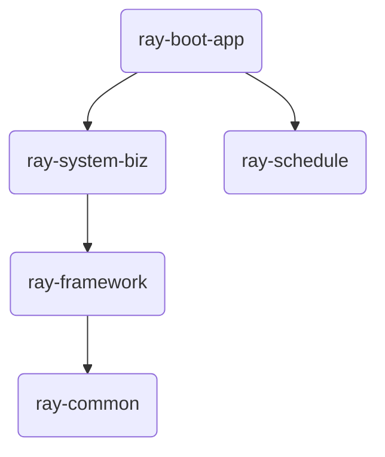

# ray-boot

[](https://openjdk.org/projects/jdk/25/)
[](https://spring.io/projects/spring-boot)
[](LICENSE)

`ray-boot` 是一个基于 **Java 25** 和 **Spring Boot 4.0.x** 构建的现代后台管理系统脚手架。它采用经典的三层架构，深度集成现代 Java 特性，旨在提供一个高性能、易扩展、且符合工程规范的开发起点。

**配套前端项目**：[ray-web](https://github.com/hanhan721/ray-web)

## 🌟 核心特性

- **现代技术栈**：紧跟 Java 25 和 Spring Boot 4.0.x，利用虚拟线程（Virtual Threads）、记录类（Record）、模式匹配等最新特性。
- **高效开发**：集成 MyBatis-Plus-Join (MPJ)，支持无需 XML 的类型安全联表查询。
- **安全可靠**：基于 Spring Security 7.x 和 JWT，提供细粒度的权限控制（功能权限 + 字段级权限）。
- **字段翻译**：内置轻量级 `@Translate` 机制，自动处理字典和关联实体的字段翻译。
- **高性能缓存**：深度适配 Valkey 9.1（Redis 的高性能替代品）。
- **工程规范**：严格的模块化设计，清晰的分层职责，完善的 API 文档。

## ✨ 项目亮点

- **Valkey：Redis 的完美开源替代**
    - [Valkey](https://github.com/valkey-io/valkey) 是由 Linux 基金会支持的 Redis 完美替代品。
    - 解决 Redis 7.2 后因商业授权协议变更（从 BSD 变为 RSALv2/SSPL）带来的法律与商业风险，保持 100% 的开源纯粹性。
- **RustFS：MinIO 的现代替代方案**
    - [RustFS](https://github.com/rustfs/rustfs) 是一款高性能、S3 兼容的对象存储系统。
    - 针对 MinIO 商业授权政策收紧的情况，提供更轻量级、更高性能（基于 Rust 零成本抽象）的开源存储选择。
- **双 Token 安全机制**
    - 深度集成 **AccessToken + RefreshToken** 登录模型。
    - AccessToken 短效性保障实时安全，RefreshToken 负责静默续期，在保障安全性的同时提供极致的用户体验。
- **现代 Java 25 生产实践**
    - 全面落地 Java 25 虚拟线程、Record、密封类等新特性，不仅是“可用”，更是“最佳实践”。

## 🏗️ 架构设计

项目采用 Maven 多模块架构，严格遵循**依赖倒置原则 (DIP)**，确保模块间解耦，增强系统的可维护性和可测试性。

### 模块依赖关系

- **依赖倒置实践**：低层模块（如 `ray-common`）通过定义接口（如 `ReferenceChecker`），由高层业务模块（如 `ray-system-biz`）实现，并利用 Spring 的集合注入机制，实现跨模块的解耦调用。

## 💎 集成功能

作为一款生产级的脚手架，`ray-boot` 内置了丰富的核心业务功能与技术组件：

### 核心业务功能
- **系统管理**：完善的用户、角色、菜单、部门、岗位管理。
- **权限控制**：
    - **功能权限**：基于 Spring Security 7.x 的动态权限检查。
    - **字段权限**：使用 `@FieldPermission` 实现响应 JSON 字段的按需隐藏。
- **字典管理**：动态配置系统参数与业务字典。
- **日志审计**：自动化记录操作日志，支持异常追踪。
- **任务调度**：集成定时任务管理。

### 核心技术组件
- **自动化翻译**：通过 `@Translate` 注解，零代码实现字典值（dict）和关联实体（entity）的名称回填。
- **高性能缓存**：基于 Valkey 9.1，提供多级缓存支持与分布式锁工具。
- **联表查询**：集成 MyBatis-Plus-Join (MPJ)，在 Service 层即可完成复杂的类型安全联表操作。
- **现代响应规范**：遵循 RFC 9457 (Problem Details) 标准化错误响应，提升前后端交互体验。
- **虚拟线程适配**：针对 Java 25 虚拟线程优化的 I/O 操作，大幅提升高并发场景下的系统吞吐量。

## 📸 项目截图

| 界面预览 1 | 界面预览 2 |
| :---: | :---: |
|  |  |

## 🛠️ 技术栈

| 类别 | 技术 |
| --- | --- |
| 核心框架 | Java 25, Spring Boot 4.0.x, Spring Framework 7.x |
| 安全框架 | Spring Security 7.x, JWT |
| 持久层 | PostgreSQL 18, MyBatis-Plus 3.5.15, MyBatis-Plus-Join |
| 缓存 | Valkey 9.1 (Spring Cache) |
| API 文档 | Knife4j (Swagger/OpenAPI 3) |
| 其他 | MapStruct, Jackson 3.x, Docker |

## 📂 项目结构

```text
ray-boot
├── ray-boot-app        # 启动模块（入口）
├── ray-system          # 系统管理模块（用户、角色、权限等）
├── ray-framework       # 框架核心模块（Web 配置、日志、异常处理）
├── ray-common          # 公共基础模块（工具类、MyBatis、Valkey 配置）
├── ray-schedule        # 任务调度模块
├── ray-business        # 业务逻辑占位模块（按需扩展）
└── docs                # 文档及 SQL 脚本
```

## 🚀 快速开始

### 1. 环境准备
- JDK 25
- PostgreSQL 18
- Valkey 9.1 (或 Redis)
- RustFS 1.0.4（对象存储，默认存储类型）
- Maven 3.9+

### 2. 数据库配置
使用 Docker Compose 启动时（见 `docker/README.md`），首次启动会自动初始化 `docs/sql/` 下的脚本；手动部署时按文件名顺序执行该目录下的 SQL 脚本。

### 3. 修改配置
编辑 `ray-boot-app/src/main/resources/application.yml`，配置数据库和 Valkey 连接信息。

### 4. 编译启动
```bash
# 编译项目
./mvnw clean install

# 运行应用
cd ray-boot-app
../mvnw spring-boot:run
```
