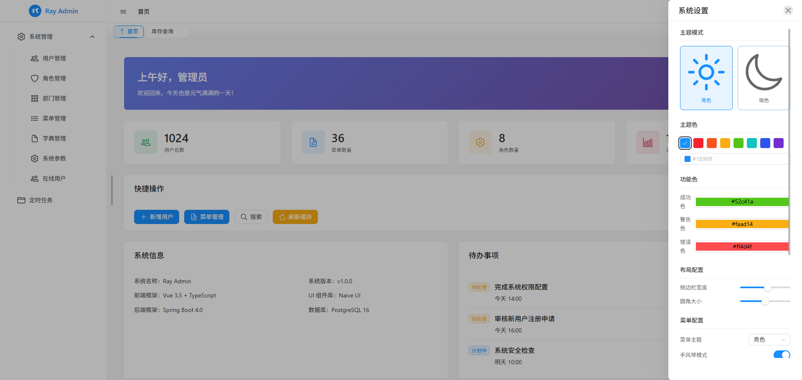
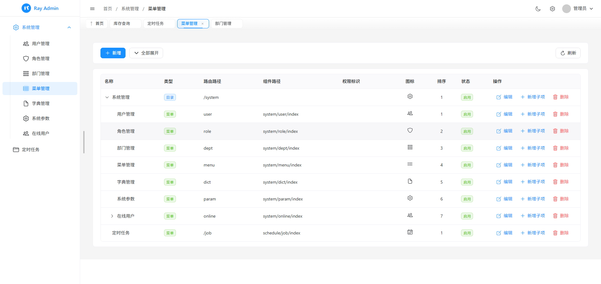

# ray-boot

[](https://openjdk.org/projects/jdk/25/)
[](https://spring.io/projects/spring-boot)
[](https://www.postgresql.org/)
[](https://github.com/valkey-io/valkey)
[](LICENSE)

基于 **Java 25 + Spring Boot 4** 的后台管理系统脚手架，采用 Controller–Service–Mapper 分层，为二次开发提供认证权限、文件管理和任务调度等基础能力。

**配套前端**：[ray-web](https://github.com/hanhan721/ray-web)

[核心特性](#核心特性) · [技术栈](#技术栈) · [快速开始](#快速开始) · [项目结构与扩展](#项目结构与扩展) · [相关文档](#相关文档) · [项目截图](#项目截图) · [开源协议](#开源协议)

## 核心特性

- **双 Token，兼顾安全与登录体验**：短效 AccessToken 处理请求，RefreshToken 轮换续期；相比单一长效 Token，在保持持续登录体验的同时缩短访问凭据泄露后的有效窗口。配合服务端会话，支持主动撤销与多设备独立管理。

- **授权快照，减少数据库访问**：普通请求一次缓存读取即可取得身份与授权快照，认证鉴权无需逐次查询用户、角色和权限表；授权变更后撤销受影响会话，要求重新登录。

- **存储按需替换，文件自动清理**：内置 RustFS（S3 协议）与 LOCAL 后端，可实现 `StorageService` 接入所需存储，业务层统一使用文件 ID 与接口；按保留期清理过期未绑定文件、已删除文件的物理对象及孤儿对象，减少无用文件占用。

- **自研任务调度，轻量够用**：基于 Spring 原生调度，随应用运行并复用项目数据库，无需引入 Quartz 或额外部署调度中心；通过 `@ScheduleTask` 标记任务，支持 Cron、任务持久化、动态启停、手动执行与日志，降低日常定时任务的接入和维护成本。

- **权限与翻译注解，减少接口样板代码**：`@PreAuthorize` 控制接口权限，`@FieldPermission` 隐藏无权查看的字段；`@EnableTranslate` + `@Translate` 自动追加字典与关联实体的可读文本，减少逐接口拼装响应字段。

- **常用能力注解化，业务代码更简洁**：`@OperateLog` 记录操作日志，`@RateLimit` 按 IP 限流，`@StorageFile` 将文件 ID 输出为结构化文件信息，减少日志、限流和文件响应处理的重复代码。

- **基础管理开箱即用**：内置用户、角色、菜单、部门、字典、系统参数、登录与操作日志，为业务开发提供现成的管理能力。

- **模块化与接口扩展，便于二次开发**：Maven 多模块组织依赖，通知渠道、字段翻译、文件引用检查等通过接口扩展，减少新增业务与基础模块的耦合。

## 技术栈

| 类别 | 技术 |
| --- | --- |
| 核心框架 | Java 25、Spring Boot 4.0.1、Spring Framework 7，启用虚拟线程 |
| 安全认证 | Spring Security 7、服务端会话、RefreshToken 轮换 |
| 数据访问 | PostgreSQL 18、MyBatis-Plus 3.5.15、MyBatis-Plus-Join 1.5.5 |
| 缓存 | Valkey 9.1、Spring Cache、Lettuce |
| 文件存储 | RustFS 1.0.4、AWS SDK for Java v2（S3）、本地磁盘 |
| 任务调度 | 基于 Spring 原生调度的自研任务管理 |
| JSON 与 API 文档 | Jackson 3、SpringDoc 3.0.1、Scalar |
| 开发工具 | Maven Wrapper、Lombok、Docker Compose |

## 快速开始

### 1. 环境准备

本地准备 **JDK 25** 和 **Docker Compose**。项目附带 Maven Wrapper，无需单独安装 Maven；Java 版本配置见 [mise.toml](mise.toml)。

PostgreSQL、Valkey 和 RustFS 可通过下面的 Compose 配置启动；使用已有服务时，可直接配置连接信息。

### 2. 启动中间件

在仓库根目录执行：

```bash
cd docker
cp .env.production .env      # PowerShell: Copy-Item .env.production .env
# 编辑 .env，设置数据库、缓存及对象存储的密码
docker compose up -d
cd ..
```

首次启动 PostgreSQL 会自动执行 [docs/sql/](docs/sql/) 中的初始化脚本。端口与数据持久化配置见 [中间件部署](docker/README.md)。

默认使用 `RUST_FS` 后端，启动应用前需按 [文件存储部署](docs/operations/file-storage.md) 预建私有桶。

如需使用本地磁盘，将 `application.yml` 中的 `ray.storage.storage-type` 改为 `LOCAL`，中间件只需启动 `docker compose up -d postgres valkey`（在 `docker/` 下执行）。切换已有存储后端前需先迁移文件数据。

### 3. 设置应用环境变量

参考 [环境变量模板](ray-boot-app/src/main/resources/.env.example)，在终端或 IDE 的运行配置中设置：

| 变量 | 用途 |
| --- | --- |
| `PG_*` | PostgreSQL 地址、端口、数据库、用户名和密码 |
| `REDIS_*` | Valkey 地址、端口和密码；应用默认使用 database 1 |
| `RAY_AUTH_REFRESH_SALT` | 必填，RefreshToken 哈希盐，建议使用至少 32 位随机串 |
| `PARAM_ENCRYPT_KEY` | 必填，32 字节随机密钥的 Base64 编码，用于系统参数 AES-256 加密 |
| `RAY_STORAGE_PUBLIC_BASE_URL` | 必填，文件访问基址；LOCAL 时填应用地址，如 `http://localhost:9527` |
| `RAY_STORAGE_SIGN_SECRET` | 必填，文件签名密钥，多实例需共用同一稳定值 |
| `RUSTFS_*` | RUST_FS 后端的地址、凭据与桶名，需与实际创建的桶一致 |

**Compose 的 `.env` 不会自动传入本地 Java 进程**。应用的连接信息需与中间件配置一致，其中 Valkey 使用 `REDIS_*` 变量。

上述四项必填的安全与文件配置没有环境变量默认值，使用 LOCAL 时也需设置。其余配置见 [application.yml](ray-boot-app/src/main/resources/application.yml)。

### 4. 构建与启动

在仓库根目录执行：

```bash
./mvnw clean install
cd ray-boot-app
../mvnw spring-boot:run
```

Windows PowerShell 使用：

```powershell
.\mvnw.cmd clean install
cd ray-boot-app
..\mvnw.cmd spring-boot:run
```

服务默认端口为 **9527**。API 文档默认关闭；启动前设置 `RAY_API_DOCS_ENABLED=true` 后，可访问 [Scalar 文档](http://localhost:9527/scalar)。

## 项目结构与扩展

```text
ray-boot/
├── ray-boot-app/     # 启动入口与应用配置
├── ray-system/       # 系统管理接口与业务实现
├── ray-framework/    # Web、字段翻译、操作日志等框架能力
├── ray-common/       # 核心工具、缓存、数据访问、安全、存储、通知
├── ray-schedule/     # 自研轻量任务调度
├── ray-business/     # 业务扩展模块占位
├── docker/           # 中间件部署
└── docs/             # SQL、部署说明与设计文档
```

通过模块依赖组织分层，根 `pom.xml` 的 `dependencyManagement` 统一管理依赖版本。

### 新增业务模块

1. 在 `ray-business/` 下创建子模块，并在 `ray-business/pom.xml` 的 `<modules>` 中登记。
2. 在根 `pom.xml` 的 `dependencyManagement` 中登记该模块版本。
3. 在 `ray-boot-app/pom.xml` 中添加模块依赖。

业务代码放在 `com.ray` 包下，Mapper 放在对应的 `mapper` 包中，由启动类统一扫描。新接口默认要求登录；需要细分权限时使用 `@PreAuthorize("@perm.has('...')")`。

### 常用扩展入口

- **通知与翻译**：实现 `Notifier` 或 `Translator` 并注册为 Spring Bean。
- **业务引用检查**：业务表保存用户、部门、角色、字典类型或文件 id 时，实现对应的 `UserReferenceChecker` / `DeptReferenceChecker` / `RoleReferenceChecker` / `DictTypeReferenceChecker` / `FileReferenceChecker`；系统删除前聚合全部实现，仍被有效业务数据引用时整批拒绝。详见[业务模块接入](docs/guides/business-module-integration.md)。
- **存储后端**：实现 `StorageService`；内置后端可由自定义 Bean 替换，按配置选择新类型时需扩展 `StorageType` 与 `StorageAutoConfiguration`。
- **定时任务**：编写带 `@ScheduleTask` 的任务 Bean，并在任务管理中登记。

## 相关文档

- [文档导航](docs/README.md)：设计、指南、运维与资产目录的分类约定。
- [业务模块接入](docs/guides/business-module-integration.md)：新建模块、扩展契约与跨模块引用检查。
- [中间件部署](docker/README.md)：Compose 配置、连接信息与数据库初始化。
- [文件存储部署](docs/operations/file-storage.md)：桶权限、本地目录、签名访问与存储迁移约束。
- [会话管理设计](docs/design/session-management.md)：RefreshToken 轮换、在线会话分页与升级说明。
- [开发约定](AGENTS.md)：分层职责、权限控制、字段翻译与代码风格。

## 项目截图

| 界面预览 1 | 界面预览 2 |
| :---: | :---: |
|  |  |

## 开源协议

本项目采用 [Apache License 2.0](LICENSE)，允许商用、修改和分发，使用时需遵守许可证中的声明保留等要求。第三方依赖遵循各自的许可。
